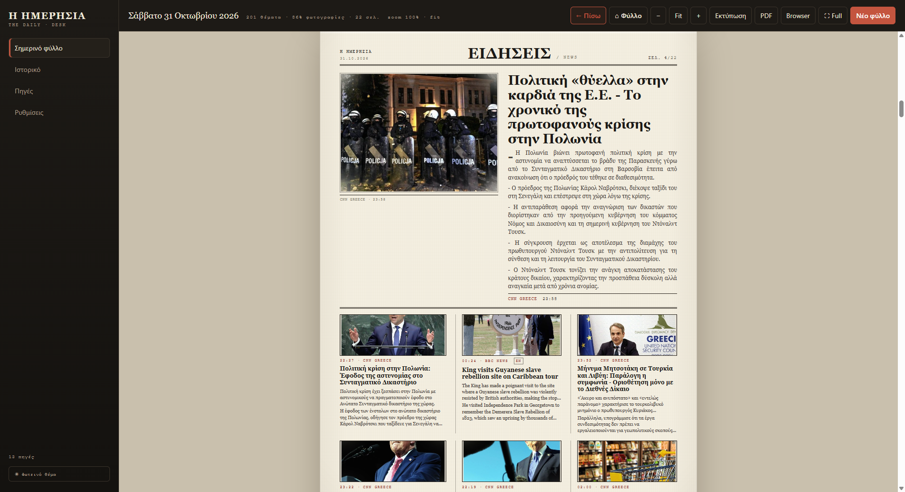
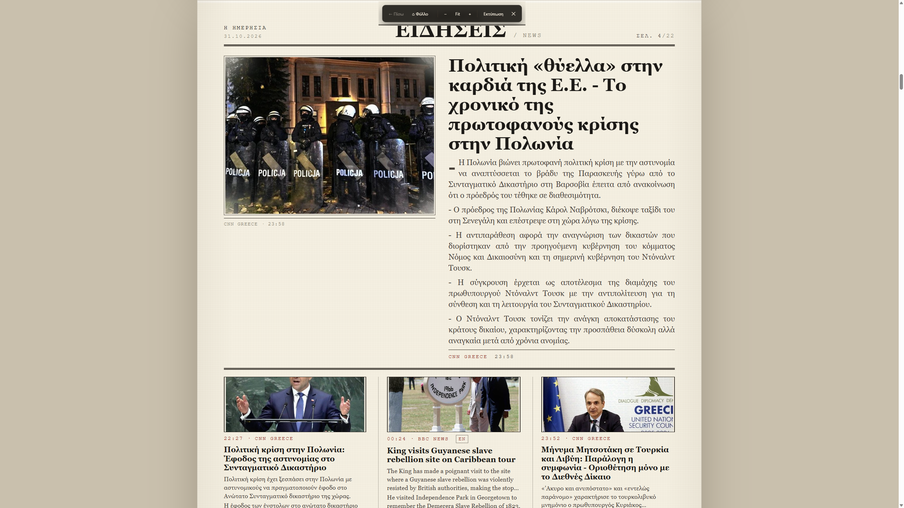

# Ανάγνωση

Το φύλλο ανοίγει μέσα στην εφαρμογή. Κυλάς με τον τροχό ή με τις μπάρες κύλισης,
όπως σε κάθε ιστοσελίδα.

<figure markdown="span">
  
  <figcaption>Κάθε σελίδα έχει την ενότητα, τον αριθμό σελίδας και τις πηγές των θεμάτων.</figcaption>
</figure>

## Άνοιγμα άρθρου

Κάνε κλικ σε έναν **τίτλο** ή σε ένα **«Άνοιξε το άρθρο»**. Το άρθρο ανοίγει
μέσα στην ίδια εφαρμογή, χωρίς να χάσεις το φύλλο.

Το κουμπί **«← Πίσω»** σε γυρίζει **στο φύλλο, στο ίδιο σημείο που διάβαζες** —
όχι στην αρχή. Δίπλα του το **«⌂ Φύλλο»** κάνει το ίδιο από οπουδήποτε.

!!! tip "Αντιγραφή συνδέσμου άρθρου"
    Όσο διαβάζεις ένα άρθρο, εμφανίζεται το κουμπί **🔗 URL** (πάνω μπάρα) ή **🔗**
    (μπάρα πλήρους οθόνης). Με ένα κλικ ο σύνδεσμος αντιγράφεται και μπορείς να τον
    στείλεις όπου θέλεις. Το ίδιο κάνει και το <kbd>Ctrl</kbd>+<kbd>Shift</kbd>+<kbd>C</kbd>.

## Μεγέθυνση (zoom)

Τρία κουμπιά στην πάνω μπάρα:

| Κουμπί | Τι κάνει |
|---|---|
| **−** | Μικραίνει το φύλλο κατά 10%. |
| **Fit** | Προσαρμόζει το φύλλο στο πλάτος του παραθύρου. |
| **+** | Μεγαλώνει το φύλλο κατά 10%. |

Η επιλογή **απομνημονεύεται πάντα**: ισχύει στις επόμενες σελίδες, στα επόμενα
φύλλα και μετά από επανεκκίνηση της εφαρμογής.

!!! note "Τα εξωτερικά άρθρα μένουν στο 100%"
    Όταν ανοίγεις ένα άρθρο από το internet, η εφαρμογή το δείχνει στο κανονικό
    μέγεθος — το zoom του φύλλου δεν το επηρεάζει.

## Πλήρης οθόνη

Πάτησε **F11** ή το κουμπί **«⛶ Full»** για ανάγνωση χωρίς περιθώρια.
Εμφανίζεται μια διακριτική μπάρα στο πάνω μέρος με:

- **← Πίσω** και **⌂ Φύλλο**
- το όνομα του site (όταν διαβάζεις άρθρο)
- **− / Fit / +**, **🔗** (αντιγραφή URL), **Εκτύπωση** και **✕**

Η μπάρα κρύβεται μόνη της όταν δεν τη χρειάζεσαι· εμφανίζεται μόλις πας τον κέρσορα ψηλά.

Για έξοδο: **Esc**, **F11**, το **✕** της μπάρας ή το μόνιμο κουμπί **✕ Exit** πάνω δεξιά.
Το **✕ Exit** μένει πάντα ορατό — ακόμη κι αν μπεις σε πλήρη οθόνη από τις **Ρυθμίσεις**,
τις **Πηγές** ή το **Ιστορικό**, όπου δεν εμφανίζεται η μπάρα ανάγνωσης.

<figure markdown="span">
  
  <figcaption>Πλήρης οθόνη: η μπάρα εμφανίζεται πάνω από το φύλλο και εξαφανίζεται μόνη της.</figcaption>
</figure>

## Άνοιγμα σε browser

Το κουμπί **«Browser»** ανοίγει το ίδιο φύλλο στον προεπιλεγμένο browser των Windows.
Χρήσιμο αν θέλεις να το δεις σε άλλη οθόνη ή να το μοιραστείς.

## Συντομεύσεις ανάγνωσης

| Πλήκτρο | Ενέργεια |
|---|---|
| <kbd>F11</kbd> | Πλήρης οθόνη / έξοδος |
| <kbd>Esc</kbd> | Έξοδος από πλήρη οθόνη |
| <kbd>Ctrl</kbd>+<kbd>P</kbd> | Εκτύπωση (ανοίγει προεπισκόπηση PDF) |
| <kbd>Ctrl</kbd>+<kbd>Shift</kbd>+<kbd>C</kbd> | Αντιγραφή URL άρθρου |

Δες όλες τις συντομεύσεις: [Συντομεύσεις](syntomeuseis.md).
