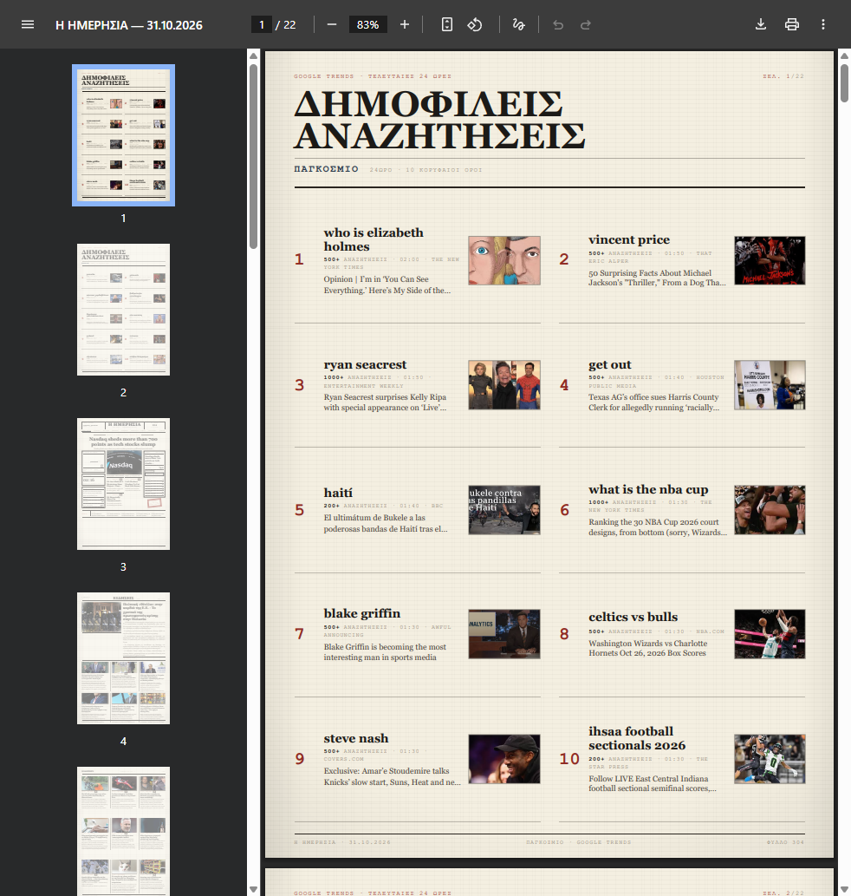
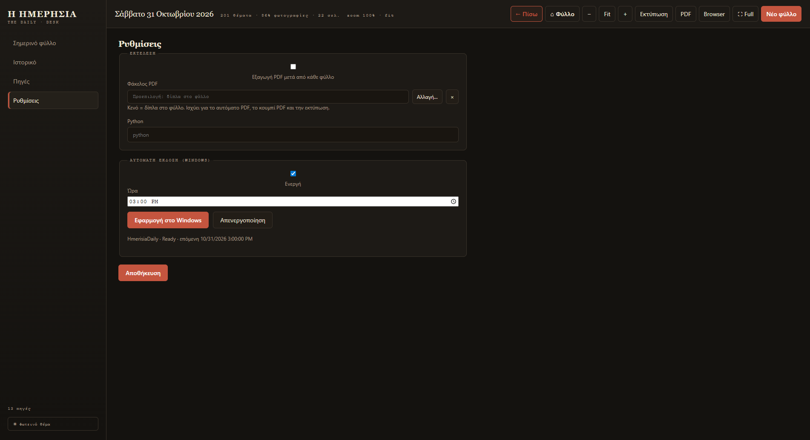

# Εκτύπωση & PDF

## Γρήγορη εκτύπωση

1. Πάτησε **«Εκτύπωση»** (πάνω μπάρα ή μπάρα πλήρους οθόνης) ή <kbd>Ctrl</kbd>+<kbd>P</kbd>.
2. Η εφαρμογή φτιάχνει πρώτα ένα σωστό PDF και το ανοίγει σε **παράθυρο προεπισκόπησης**.
3. Έλεγξε ότι όλα φαίνονται σωστά και πάτησε το **εικονίδιο του εκτυπωτή** μέσα σε αυτό το παράθυρο.
4. Διάλεξε εκτυπωτή και πάτησε **Εκτύπωση**.

<figure markdown="span">
  
  <figcaption>Η προεπισκόπηση δείχνει όλες τις σελίδες. Η εκτύπωση ξεκινά από το εικονίδιο του εκτυπωτή (πάνω δεξιά).</figcaption>
</figure>

!!! warning "Σημαντικό: εκτύπωσε από το παράθυρο προεπισκόπησης"
    Μην ψάχνεις κουμπί εκτύπωσης μέσα στην κύρια οθόνη της εφαρμογής.
    Η εκτύπωση **γίνεται πάντα από τον viewer του PDF** που ανοίγει αυτόματα.
    Έτσι αποφεύγονται οι κενές σελίδες που έβγαιναν παλιότερα.

## Αποθήκευση ως PDF

Έχεις δύο τρόπους:

| Ενέργεια | Αποτέλεσμα |
|---|---|
| **«Εκτύπωση»** → εκτυπωτής *Microsoft Print to PDF* | Αποθηκεύεις όπου θέλεις, με το όνομα που θέλεις. |
| **«PDF»** (πάνω μπάρα) | Δημιουργεί απευθείας το PDF στον φάκελο PDF και σου δείχνει τη διαδρομή. |

Το αρχείο ονομάζεται **`efimerida-<ημερομηνία>.pdf`** και είναι A4, κάθετο όπως το φύλλο,
με τις ίδιες σελίδες και τα ίδια χρώματα.

## Φάκελος PDF

Από προεπιλογή, το PDF γράφεται **δίπλα στο φύλλο**:
`%APPDATA%\hmerisia-desktop\output\<ημερομηνία>\`.

Για να το αλλάξεις:

1. **Ρυθμίσεις → Εκτέλεση**.
2. Στο **Φάκελος PDF** πάτησε **«Αλλαγή…»** και διάλεξε φάκελο.
3. Πάτησε **Αποθήκευση**.
4. Με το **×** επιστρέφεις στην προεπιλογή.

<figure markdown="span">
  
  <figcaption>Ο φάκελος PDF ισχύει για το αυτόματο PDF, το κουμπί «PDF» και την εκτύπωση.</figcaption>
</figure>

!!! tip "Αν ο φάκελος δεν είναι εγγράψιμος"
    Η εφαρμογή το καταλαβαίνει και γράφει το PDF δίπλα στο φύλλο,
    χωρίς να κολλήσει η διαδικασία.

## Αυτόματο PDF με κάθε φύλλο

Στις **Ρυθμίσεις → Εκτέλεση** ενεργοποίησε **«Εξαγωγή PDF μετά από κάθε φύλλο»**.
Από τότε, κάθε νέο φύλλο (και της αυτόματης έκδοσης) αφήνει και το PDF του
στον φάκελο που όρισες.

## Αν η εκτύπωση βγει κενή

1. Βεβαιώσου ότι πατάς το **εικονίδιο εκτυπωτή μέσα στο παράθυρο προεπισκόπησης**.
2. Αν ο εκτυπωτής είναι **Microsoft Print to PDF**, το «χαρτί» είναι αρχείο —
   διάλεξε πού θα αποθηκευτεί.
3. Δοκίμασε ξανά το **«PDF»** από την πάνω μπάρα· αν το PDF ανοίγει σωστά,
   το πρόβλημα είναι στον εκτυπωτή και όχι στο φύλλο.
