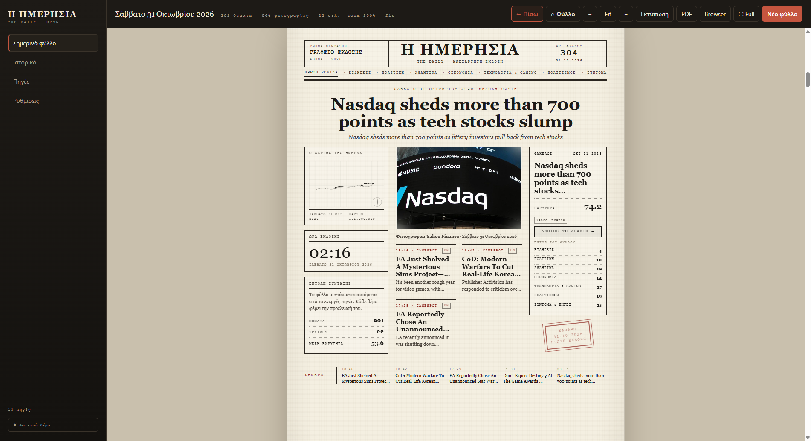

# Η ΗΜΕΡΗΣΙΑ

Η **Η ΗΜΕΡΗΣΙΑ** συντάσσει **αυτόματα** μια καθημερινή εφημερίδα στον υπολογιστή σου:
μαζεύει ειδήσεις από τις πηγές που διάλεξες, τις τακτοποιεί σε στήλες και σελίδες
και σου παραδίδει ένα πλήρες φύλλο — έτοιμο για ανάγνωση, εκτύπωση ή PDF.

Δεν χρειάζεται να γράψεις τίποτα. Πατάς ένα κουμπί και σε λίγα λεπτά το φύλλο είναι έτοιμο.

<figure markdown="span">
  
  <figcaption>Η πρώτη σελίδα του φύλλου, όπως την βλέπεις μέσα στην εφαρμογή.</figcaption>
</figure>

## Σε 60 δευτερόλεπτα

1. **Άνοιξε την εφαρμογή** «Η ΗΜΕΡΗΣΙΑ» από την Επιφάνεια εργασίας ή το μενού Έναρξη.
2. Πάτησε **«Νέο φύλλο»** (πάνω δεξιά).
3. Περίμενε όσο γεμίζει η **μπάρα προόδου**. Συνήθως διαρκεί λίγα λεπτά.
4. Μόλις εμφανιστεί, **διάβασε** το φύλλο κάνοντας κύλιση ή κλικ σε έναν τίτλο.
5. Προαιρετικά, πάτησε **«Εκτύπωση»** για να το τυπώσεις ή να το κρατήσεις ως PDF.

!!! tip "Θέλεις να γίνεται μόνο του κάθε πρωί;"
    Άνοιξε **Ρυθμίσεις → Αυτόματη έκδοση**, διάλεξε ώρα και πάτησε
    **«Εφαρμογή στο Windows»**. Από τότε το φύλλο θα είναι έτοιμο στις 07:00,
    ακόμα και με την εφαρμογή κλειστή. [Περισσότερα εδώ](programmatismos.md).

## Τι περιέχει ένα φύλλο

- **Μία ενότητα ανά πηγή**: BBC, CNN Greece, Yahoo Finance, IMDb, κάθε κανάλι YouTube…
- Η κάθε πηγή παίρνει 1–2 σελίδες ανάλογα με το βάρος της. Με 11 πηγές στο weight 1.0
  το φύλλο βγαίνει συνήθως **14 σελίδες** (+2 αν είναι ενεργά τα Google Trends).
- Στο τέλος υπάρχουν πάντα **Σύντομα & Αριθμοί** και **Πηγές & Στοιχεία**.
- Κάθε θέμα κρατά την πηγή του («CNN GREECE», «BBC NEWS» κ.λπ.) και την ώρα του.

## Τι χρειάζεσαι

| Απαίτηση | Σημείωση |
|---|---|
| Windows 10 ή 11 | 64-bit |
| Σύνδεση στο internet | Μόνο όσο συντάσσεται το φύλλο |
| Χώρος στον δίσκο | Λίγα MB για κάθε φύλλο + cache εικόνων |

## Ο οδηγός με μια ματιά

- **[Εγκατάσταση](egkatastasi.md)** — πώς στήνεται η εφαρμογή και πού αποθηκεύει τα φύλλα.
- **[Νέο φύλλο](kathimerini-ekdosi.md)** — τι ακριβώς κάνει το κουμπί και τι σημαίνει η πρόοδος.
- **[Ανάγνωση](anagnosi.md)** — κύλιση, zoom, πλήρης οθόνη, «← Πίσω», αντιγραφή συνδέσμου.
- **[Εκτύπωση & PDF](ektyposi-pdf.md)** — σωστή εκτύπωση χωρίς κενές σελίδες.
- **[Πηγές](piges.md)** — πρόσθεσε, βάλε σε παύση ή δοκίμασε μια πηγή.
- **[Google Trends](trends.md)** — οι δημοφιλέστερες αναζητήσεις του 24ώρου.
- **[Αυτόματη έκδοση](programmatismos.md)** — κάθε πρωί στις 07:00, χωρίς να ανοίξεις τίποτα.
- **[Καθαρισμός](katharismos.md)** — σβήσε παλιά φύλλα και cache με ένα κλικ.
- **[Προβλήματα](provlimata.md)** — οι συνηθισμένες «σπαζοκεφαλιές» και οι λύσεις τους.

!!! note "Πού αποθηκεύονται τα φύλλα;"
    Στον φάκελο `%APPDATA%\hmerisia-desktop\output\<ημερομηνία>\`.
    Μπορείς να τον ανοίξεις από τα **Windows** πληκτρολογώντας `%APPDATA%` στη γραμμή διευθύνσεων.
