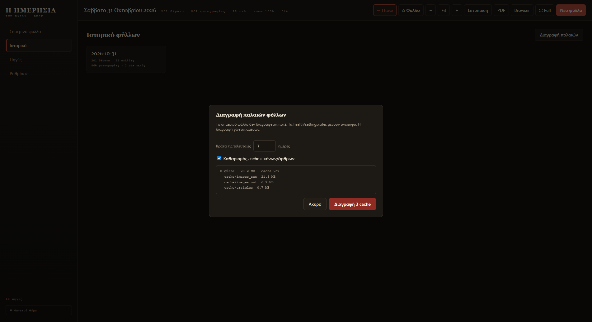

# Καθαρισμός παλιών φύλλων

Κάθε φύλλο πιάνει χώρο (εικόνες, άρθρα, PDF). Από το **Ιστορικό** μπορείς να
σβήσεις ό,τι δεν χρειάζεσαι — με ένα κλικ, χωρίς πληκτρολόγηση.

<figure markdown="span">
  
  <figcaption>Βλέπεις πόσα φύλλα, πόσα MB και πόση cache θα διαγραφούν πριν πατήσεις.</figcaption>
</figure>

## Καθαρισμός πολλών φύλλων

1. Άνοιξε **Ιστορικό**.
2. Πάτησε **«Διαγραφή παλαιών»** (πάνω δεξιά).
3. Όρισε **«Κράτα τις τελευταίες … ημέρες»** (προεπιλογή 7).
4. Άφησε τσεκαρισμένο το **«Καθαρισμός cache εικόνων/άρθρων»** αν θέλεις να ελευθερώσεις κι άλλο χώρο.
5. Δες την προεπισκόπηση, π.χ. *«3 φύλλα · 120 MB · cache ναι»*.
6. Πάτησε το κόκκινο **«Διαγραφή …»**.

Η διαγραφή γίνεται **αμέσως** — δεν υπάρχει δεύτερο «είσαι σίγουρος;».

!!! warning "Τι δεν διαγράφεται ποτέ"
    - Το **σημερινό** φύλλο.
    - Οι **ρυθμίσεις**, οι **πηγές** και το **ιστορικό υγείας** των πηγών.
    - Τα φύλλα που είναι μέσα στις ημέρες που κρατάς.

## Τι διαγράφεται

| Στοιχείο | Τι σβήνεται |
|---|---|
| Φύλλο | Το HTML και ο φάκελός του. |
| PDF | Το αντίστοιχο `efimerida-<ημερομηνία>.pdf` (όπου κι αν το έβαλες). |
| Cache | Εικόνες, άρθρα και προσωρινά αρχεία. |

## Διαγραφή ενός μόνο φύλλου

Στο **Ιστορικό**, πάνω σε κάθε κάρτα φύλλου υπάρχει **×**.
Θα σου ζητήσει επιβεβαίωση μία φορά και μετά διαγράφει το φύλλο **και** το PDF του.

## Πόσο χώρο πιάνει

Ένα φύλλο με εικόνες κυμαίνεται συνήθως στα **20–40 MB** μαζί με το PDF.
Η cache μπορεί να φτάσει αρκετές εκατοντάδες MB αν δεν καθαρίζεται.

!!! tip "Τακτική συνήθεια"
    Μία φορά τον μήνα: **Ιστορικό → Διαγραφή παλαιών → κράτα 7 ημέρες → Καθαρισμός cache**.
    Έτσι κρατάς την εφαρμογή ελαφριά χωρίς να χάνεις τα πρόσφατα φύλλα.
