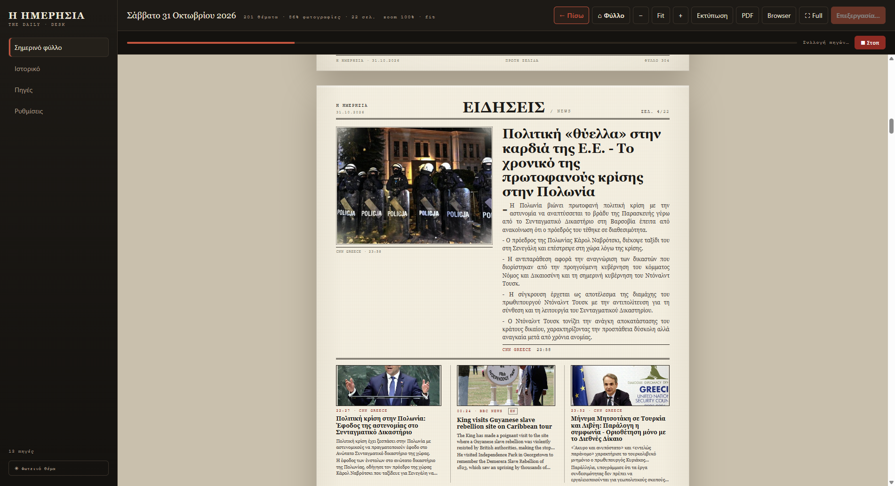

# Νέο φύλλο

Το κουμπί **«Νέο φύλλο»** (πάνω δεξιά) στρώνει όλη τη δουλειά: μαζεύει ειδήσεις,
διαλέγει τα καλύτερα θέματα, μεταφράζει τα αγγλικά, κατεβάζει εικόνες και συντάσσει
τις σελίδες.

<figure markdown="span">
  
  <figcaption>Κατά τη διάρκεια της έκδοσης βλέπεις την πρόοδο και μπορείς να τη σταματήσεις.</figcaption>
</figure>

## Τι συμβαίνει όσο περιμένεις

| Στάδιο | Τι γίνεται |
|---|---|
| **Συλλογή πηγών** | Διαβάζει όλες τις ενεργές πηγές σου (RSS, ιστοσελίδες, YouTube). |
| **Σελιδοποίηση** | Χωρίζει τα θέματα ανά πηγή και υπολογίζει τις σελίδες από το βάρος της. |
| **Άρθρα** | Κατεβάζει το πλήρες κείμενο κάθε θέματος. |
| **Μετάφραση** | Μεταφράζει στα ελληνικά τα αγγλικά θέματα (αν είναι ενεργό). |
| **Εικόνες** | Κατεβάζει και προσαρμόζει τις φωτογραφίες. |
| **Σύνθεση** | Χτίζει το φύλλο και το ανοίγει στην οθόνη. |
| **Εξαγωγή PDF** | Αν είναι ενεργή η εξαγωγή, φτιάχνει και το PDF. |

Η διάρκεια εξαρτάται από το internet και τον αριθμό των πηγών — συνήθως **2–5 λεπτά**.

## Το κουμπί «■ Στοπ»

Βρίσκεται δεξιά από την μπάρα προόδου. Με ένα κλικ **σταματά αμέσως** τη σύνταξη,
ό,τι κι αν κάνει εκείνη τη στιγμή. Το προηγούμενο φύλλο μένει ανέπαφο.

!!! tip "Σταμάτησε κατά λάθος;"
    Πάτησε ξανά **«Νέο φύλλο»**. Η νέα έκδοση ξεκινά από την αρχή.

## Τι γίνεται με το σημερινό φύλλο

- Αν υπάρχει ήδη φύλλο για σήμερα, **αντικαθίσταται** από το νέο.
- Τα παλιότερα φύλλα μένουν στο **Ιστορικό** μέχρι να τα διαγράψεις.
- Το φύλλο αποθηκεύεται ως `efimerida-<ημερομηνία>.html` στον φάκελο
  `output\<ημερομηνία>\`.

!!! note "Έκδοση χωρίς να ανοίξεις την εφαρμογή"
    Γι' αυτό υπάρχει η **Αυτόματη έκδοση**: το Windows Task Scheduler τρέχει
    τη μηχανή σύνταξης στις 07:00 ανεξάρτητα από την εφαρμογή.
    [Δες πώς ρυθμίζεται](programmatismos.md).

## Αν κάτι πάει στραβά

- **«Εκτελείται ήδη…»** — υπάρχει έκδοση σε εξέλιξη. Περίμενε ή πάτησε **Στοπ**.
- **Κολλάει στο «Συλλογή πηγών»** — κάποια πηγή αργεί. Δοκίμασε **Στοπ** και ξανά.
- **Βγαίνει φύλλο με λίγα θέματα** — έλεγξε ότι οι πηγές είναι **ενεργές** και ότι
  έχεις internet. Δες [Πηγές](piges.md) και [Προβλήματα](provlimata.md).
