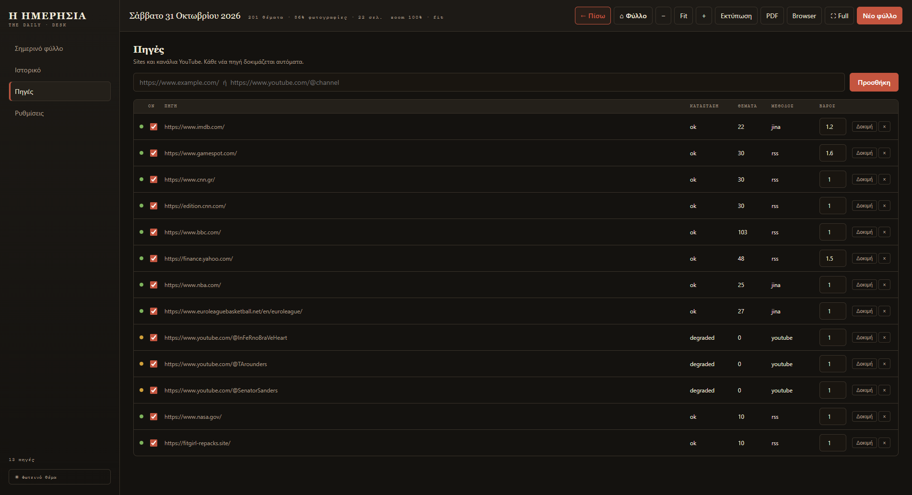

# Πηγές

Η εφαρμογή τραβά ειδήσεις από **sites** και **κανάλια YouTube**. Στην οθόνη
**Πηγές** βλέπεις όλες τις πηγές σου, την κατάστασή τους και μπορείς να τις
ενεργοποιείς ή να τις βάζεις σε παύση.

<figure markdown="span">
  
  <figcaption>Κάθε γραμμή είναι μια πηγή. Το πρώτο κουτάκι δείχνει αν θα τρέξει στο επόμενο φύλλο.</figcaption>
</figure>

## Τι σημαίνουν οι στήλες

| Στήλη | Σημασία |
|---|---|
| **On** | ✅ Η πηγή τρέχει στο επόμενο φύλλο. ☐ Δεν τρέχει καθόλου (παράλειψη). |
| **Πηγή** | Η διεύθυνση του site ή του καναλιού. |
| **Κατάσταση** | `ok` = δουλεύει, `degraded` = δουλεύει μερικώς, `unknown` = δεν έχει ελεγχθεί ακόμα. |
| **Θέματα** | Πόσα θέματα βρήκε στην τελευταία συλλογή. |
| **Μέθοδος** | `rss` (feed), `jina` (ανάγνωση σελίδας), `youtube` (κανάλι). |
| **Βάρος** | Πόσο «δυνατά» μπαίνει στη σελιδοποίηση (0.3–2.0). |

## Ενεργοποίηση / παύση

Πάτησε το κουτάκι **On** στη γραμμή που θέλεις.

- Ανενεργή πηγή → η γραμμή θαμπώνει και το URL διαγράφεται.
- Η αλλαγή **ισχύει αμέσως** για το επόμενο φύλλο, χωρίς επανεκκίνηση.
- Οι ανενεργές πηγές **δεν κατεβάζουν τίποτα** — ούτε άρθρα ούτε εικόνες.

!!! tip "Δοκίμασε πριν την απενεργοποιήσεις"
    Το κουμπί **«Δοκιμή»** ελέγχει την πηγή εκείνη τη στιγμή και ενημερώνει
    την κατάσταση και τον αριθμό θεμάτων. Χρήσιμο όταν μια πηγή «κοιμάται».

## Ρύθμιση βάρους

Το **Βάρος** επηρεάζει πόσα θέματα θα πάρει μια πηγή σε σχέση με τις άλλες:

- **1.0** — κανονικό.
- **1.5–2.0** — περισσότερα θέματα από αυτή την πηγή.
- **0.3–0.7** — λιγότερα, μόνο τα πιο σημαντικά.

Πάτησε <kbd>Enter</kbd> ή πάτησε αλλού για να αποθηκευτεί.

## Προσθήκη πηγής

1. Γράψε τη διεύθυνση στο πεδίο πάνω από τον πίνακα.
   Δέχεται και κανάλια YouTube, π.χ. `https://www.youtube.com/@channel`.
2. Πάτησε **«Προσθήκη»**.
3. Η εφαρμογή **δοκιμάζει αυτόματα** την πηγή. Αν βρει θέματα, την προσθέτει με `ok`.

!!! note "Τι γίνεται αν δεν βρεθεί τίποτα;"
    Η πηγή μένει στον πίνακα με `degraded` ή `unknown`. Μπορεί να μην έχει
    δημόσιο RSS — δοκίμασε ξανά αργότερα ή αφαίρεσέ την.

## Αφαίρεση πηγής

Πάτησε το **×** στο τέλος της γραμμής. Η πηγή φεύγει οριστικά από τη λίστα
(τα παλιά φύλλα δεν αλλάζουν).

## Καλή πρακτική

- Κράτα **10–20 ενεργές πηγές** για ισορροπημένο φύλλο.
- Βάλε **βάρος 1.5** στις πηγές που εμπιστεύεσαι περισσότερο.
- Κλείσε προσωρινά όσες αργούν ή βγάζουν παλιά θέματα — δεν χρειάζεται να τις σβήσεις.
