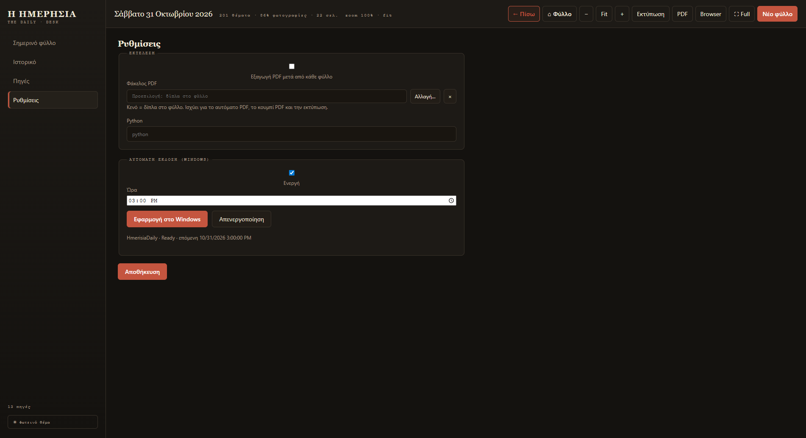

# Αυτόματη έκδοση (07:00)

Η εφαρμογή μπορεί να συντάσσει το φύλλο **μόνη της κάθε πρωί**, χωρίς να την ανοίξεις.
Η δουλειά ανατίθεται στον **Windows Task Scheduler**, οπότε δεν χρειάζεται ούτε
παράθυρο ανοιχτό ούτε η εφαρμογή σε λειτουργία.

<figure markdown="span">
  
  <figcaption>Ενεργοποίηση, ώρα και εφαρμογή στο Windows.</figcaption>
</figure>

## Ρύθμιση

1. **Ρυθμίσεις → Αυτόματη έκδοση (Windows)**.
2. Τσέκαρε **«Ενεργή»**.
3. Διάλεξε **Ώρα** (προεπιλογή **07:00**).
4. Πάτησε **«Εφαρμογή στο Windows»**.
5. Πάτησε **Αποθήκευση**.

Κάτω από τα κουμπιά θα δεις επιβεβαίωση, π.χ.:
*«HmerisiaDaily · Ready · επόμενη 31/10/2026 07:00»*.

Από εκείνη τη στιγμή, κάθε μέρα την ίδια ώρα, το φύλλο θα είναι έτοιμο πριν καν ανοίξεις την εφαρμογή.

## Τι ακριβώς τρέχει

- Το Windows ξεκινά μια μικρή εντολή (`run-daily.cmd`) που καλεί τη **μηχανή σύνταξης**
  της εφαρμογής με την επιλογή «σήμερα».
- Η μηχανή δουλεύει **ανεξάρτητα** από την εφαρμογή.
- Όταν ανοίξεις την εφαρμογή, το φύλλο της ημέρας είναι ήδη εκεί.

## Παύση ή αλλαγή ώρας

- **Αλλαγή ώρας:** διάλεξε νέα ώρα και ξαναπάτησε **«Εφαρμογή στο Windows»**.
- **Παύση:** πάτησε **«Απενεργοποίηση»**. Η προγραμματισμένη εργασία αφαιρείται.

!!! warning "Ο υπολογιστής πρέπει να είναι ανοιχτός"
    Αν το PC είναι **τερματισμένος** την ώρα της έκδοσης, η εργασία δεν τρέχει.
    Αν είναι σε **αναμονή**, εξαρτάται από τις ρυθμίσεις του Windows —
    η εφαρμογή δεν αλλάζει τις επιλογές «ξύπνημα» του συστήματος.

## Σταμάτημα προγραμματισμένης έκδοσης

Αν ανοίξεις την εφαρμογή την ώρα που τρέχει η αυτόματη έκδοση, θα δεις την μπάρα
προόδου. Το **«■ Στοπ»** τερματίζει και την προγραμματισμένη εργασία.

## Αν δεν τρέχει

1. Άνοιξε **Ρυθμίσεις → Αυτόματη έκδοση** και βεβαιώσου ότι είναι **Ενεργή**.
2. Πάτησε ξανά **«Εφαρμογή στο Windows»**.
3. Άνοιξε το **Task Scheduler** των Windows και έλεγξε την εργασία **`HmerisiaDaily`**.
4. Βεβαιώσου ότι η εφαρμογή είναι **εγκατεστημένη** (όχι απλώς αντιγραμμένη σε φάκελο) —
   η εργασία δείχνει στο εκτελέσιμο της εγκατάστασης.

Περισσότερα: [Προβλήματα](provlimata.md).
