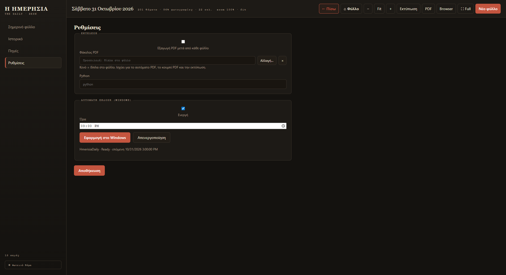

# Όλες οι ρυθμίσεις

Ό,τι αλλάζεις στις **Ρυθμίσεις** ισχύει από το **επόμενο** φύλλο. Οι περισσότερες
ρυθμίσεις θέλουν **«Αποθήκευση»** στο κάτω μέρος· η σειρά και το βάρος των πηγών
αποθηκεύονται **αμέσως** μόλις τα αλλάξεις.

<figure markdown="span">
  
  <figcaption>Οι πιο συχνές ρυθμίσεις: φάκελος PDF και ώρα αυτόματης έκδοσης.</figcaption>
</figure>

## Έκδοση

| Ρύθμιση | Τι αλλάζει |
|---|---|
| **Τίτλος** | Το όνομα στην κορυφή κάθε σελίδας (προεπιλογή: Η ΗΜΕΡΗΣΙΑ). |
| **Υπότιτλος** | Η δεύτερη γραμμή (προεπιλογή: THE DAILY). |

## Ενότητες ανά πηγή

Κάθε ενεργή πηγή γίνεται δική της ενότητα. Σε αυτό το σημείο βλέπεις:

| Στοιχείο | Τι κάνει |
|---|---|
| **⠿** | Σύρε για να αλλάξεις τη σειρά των ενοτήτων. |
| **On** | Ενεργοποίηση/παύση της πηγής για το επόμενο φύλλο. |
| **Θέματα** | Πόσα θέματα βρήκε στην τελευταία συλλογή. |
| **Βάρος** | 0.3–2.0. Ορίζει και τις σελίδες: `max(1, round(weight))`. |
| **Σελίδες** | Η εκτίμηση σελίδων από το βάρος. |

Οι σελίδες είναι **οδηγός**, όχι υποχρέωση:

- Weight 1.0 → 1 σελίδα, weight 1.5–2.0 → 2 σελίδες.
- Αν η πηγή δεν έχει αρκετά θέματα, παίρνει λιγότερες ή καμία.
- Οι σελίδες που περισσεύουν **δεν** πάνε σε άλλη πηγή.
- Με 11 πηγές στο weight 1.0 το φύλλο βγαίνει συνήθως **14 σελίδες**
  (16 με Trends). Αν θέλεις μεγαλύτερο φύλλο, ανέβασε βάρος σε πηγές με υλικό.

!!! tip "Σειρά = προτεραιότητα"
    Η σειρά των πηγών είναι η σειρά των ενοτήτων, η σειρά στη σελίδα
    «Πηγές & Στοιχεία» και το κριτήριο ισοπαλίας στη βαθμολόγηση.

## Όρια λέξεων

Πόσο μεγάλα επιτρέπεται να είναι τα κείμενα ώστε να χωρούν στη σελίδα:

| Πεδίο | Τι αφορά | Προεπιλογή |
|---|---|---|
| **Lead** | Το κύριο θέμα της πρώτης σελίδας | 900 |
| **Featured** | Τα μεγάλα θέματα | 420 |
| **Θέμα** | Τα κανονικά θέματα | 240 |
| **Σύντομο** | Τα μικρά («Σύντομα») | 90 |
| **Βίντεο** | Οι καταχωρήσεις βίντεο | 190 |

Μεγαλύτερος αριθμός = περισσότερο κείμενο, πιο «γεμάτη» σελίδα.

## Εμφάνιση

| Ρύθμιση | Τι αλλάζει |
|---|---|
| **Χαρτί** | Το χρώμα του χαρτιού. |
| **Μελάνι** | Το χρώμα του κειμένου. |
| **Έμφαση** | Το χρώμα των τίτλων/γραμμών. |

## Εμφάνιση φύλλου

| Ρύθμιση | Επιλογές |
|---|---|
| **Θέμα** | `Light (σέπια)`, `Dark (νυχτερινό)`, `Color (λευκό + χρώμα)` |
| **Φωτογραφίες** | `Sepia` ή `Έγχρωμες` |
| **Accent** | Το χρώμα έμφασης του φύλλου |
| **Μέγεθος γραμματοσειρών** | Από 0.9 έως 1.15 |

## Γλώσσα

**«Μετάφραση αγγλικών στα ελληνικά»** — όταν είναι ενεργό, τα αγγλικά θέματα
μεταφράζονται. Όταν είναι κλειστό, μένουν αγγλικά με ένδειξη **EN**.

## Google Trends

[Αναλυτικά εδώ](trends.md): ενεργοποίηση, χώρα, όροι ανά σελίδα.

## Εκτέλεση

| Ρύθμιση | Τι κάνει |
|---|---|
| **Εξαγωγή PDF μετά από κάθε φύλλο** | Φτιάχνει αυτόματα και το PDF. |
| **Φάκελος PDF** | Πού αποθηκεύεται το PDF. Κενό = δίπλα στο φύλλο. |
| **Python** | Μόνο για ειδικές περιπτώσεις — άφησέ το όπως είναι. |

## Αυτόματη έκδοση

[Αναλυτικά εδώ](programmatismos.md): ενεργοποίηση, ώρα, εφαρμογή/απενεργοποίηση στο Windows.

## Πού αποθηκεύονται οι ρυθμίσεις

Στο αρχείο `%APPDATA%\hmerisia-desktop\settings.json`.
Δεν χρειάζεται να το ανοίξεις ποτέ χειροκίνητα — όλα γίνονται από την οθόνη Ρυθμίσεις.
