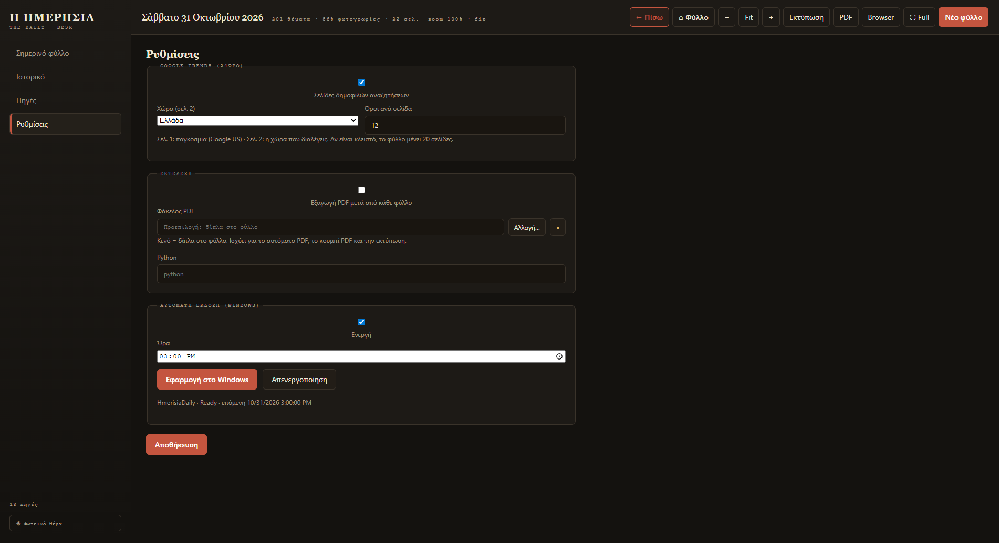

# Google Trends

Οι δύο πρώτες σελίδες του φύλλου μπορούν να δείχνουν τις **δημοφιλέστερες
αναζητήσεις του τελευταίου 24ώρου** από το Google Trends: μια σελίδα για όλο τον
κόσμο και μια για τη χώρα που διαλέγεις.

<figure markdown="span">
  
  <figcaption>Ενεργοποίηση, χώρα και αριθμός όρων ανά σελίδα.</figcaption>
</figure>

## Ενεργοποίηση

**Ρυθμίσεις → Google Trends (24ωρο)** → τσέκαρε **«Σελίδες δημοφιλών αναζητήσεων»** → **Αποθήκευση**.

- Με ενεργές τις σελίδες: **+2 σελίδες** μπροστά από το κανονικό φύλλο.
- Με κλειστές: το φύλλο βγαίνει χωρίς τις δύο σελίδες Trends.
- Το σύνολο εξαρτάται πλέον από τις πηγές/βάρη, όχι από σταθερό αριθμό σελίδων.

Η αλλαγή ισχύει από το **επόμενο** φύλλο. Το σημερινό δεν ξαναχτίζεται μόνο του.

## Χώρα (σελίδα 2)

Η **σελίδα 1** είναι πάντα **παγκόσμια** (Google US).
Η **σελίδα 2** δείχνει τη χώρα που διαλέγεις από τη λίστα — προεπιλογή **Ελλάδα**.

Υπάρχουν 35+ χώρες στη λίστα (Ελλάδα, Κύπρος, ΗΠΑ, Γερμανία, Γαλλία, Ιταλία, Ισπανία κ.λπ.).

## Όροι ανά σελίδα

Από **5 έως 12**. Η προεπιλογή είναι **10**.

Κάθε όρος εμφανίζεται με:

- τον τίτλο της αναζήτησης,
- τον όγκο αναζητήσεων,
- την ώρα / πηγή,
- μια μικρή εικόνα (όταν υπάρχει).

## Πώς συμπεριφέρεται όταν το Google «θολώνει»

Το Google Trends δεν δίνει πάντα δεδομένα (μερικές φορές απαντά με σφάλμα).
Η εφαρμογή:

1. Δοκιμάζει ξανά αυτόματα.
2. Αν αποτύχει, χρησιμοποιεί την **τελευταία γνωστή λίστα** (cache 60 λεπτών).
3. Αν δεν υπάρχει cache, το φύλλο βγαίνει **χωρίς** τις σελίδες Trends — δεν χαλάει η έκδοση.

!!! tip "Θέλεις μόνο τη χώρα σου;"
    Δεν γίνεται να αφαιρεθεί μόνο η παγκόσμια σελίδα· οι δύο σελίδες πάνε πάντα μαζί.
    Αν δεν σε ενδιαφέρουν, κλείσε εντελώς τις σελίδες Trends.

!!! note "Οι εικόνες των Trends"
    Κατεβαίνουν από το Google και αποθηκεύονται στην cache, ώστε το φύλλο
    να ανοίγει γρήγορα και χωρίς internet την επόμενη φορά.
